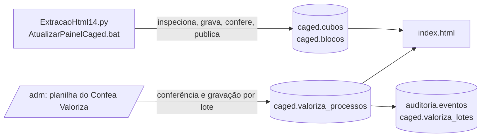

# Painel CAGED × Sistema CONFEA/CREA

| Item | Valor |
|---|---|
| Painel | https://cnfpresiddata.github.io/cagedcnfcr/ |
| Administração do Confea Valoriza | https://cnfpresiddata.github.io/cagedcnfcr/adm/ |
| Banco | Supabase `rmjlqngrfgorhcwaarou` (banco único CONFEA), schema `caged` |
| Autor | Bruno-LSO |

## Como funciona

O painel não leva mais os dados dentro do HTML (eram 17,8 MB). Ele abre, lê a versão publicada no Supabase e monta o mesmo objeto de dados que o pipeline Python montava. Os cubos ficam guardados no navegador (IndexedDB) até sair uma versão nova.

## Banco (schema `caged`)

| Tabela | Conteúdo |
|---|---|
| `execucoes` | Cada carga do pipeline. Só uma fica com status `publicada`. |
| `cubos` | Cubos do painel em formato colunar: uma linha por coluna, array do menor tipo inteiro que cabe (`i2`, `i4`, `i8`) ou `f8`. Chave: execução, cubo e coluna. |
| `blocos` | Dicionários (`dims`), metadados, malha das UFs e a ordem das chaves, em `json` comprimido. |
| `valoriza_processos` | Base do Confea Valoriza. Uma linha por processo; a coluna Nº da planilha é a chave. |
| `valoriza_lotes` | Cada gravação na base: importação, inclusão, alteração, remoção ou reversão. |
| `historico` (view) | Eventos legíveis de `auditoria.eventos` do projeto `caged`. |

Regras de integridade:

- a publicação troca a versão no ar numa só transação e apaga os dados da versão anterior;
- antes de gravar, o pipeline confere chave sem repetição, índices dentro dos dicionários e totais iguais entre os cubos; depois de gravar, compara no banco tamanho, soma, mínimo e máximo de cada coluna;
- a base do Valoriza só muda pelas funções `valoriza_importar`, `valoriza_salvar`, `valoriza_excluir` e `valoriza_reverter`; cada uma abre um lote, e os gatilhos registram cada linha com o lote;
- um lote só é desfeito se nenhum processo dele mudou depois; senão a função diz qual lote desfazer antes.

## Leitura da planilha (`valoriza.js`)

Porte fiel de `integrar_valoriza()` do pipeline Python: salário por vaga, jornada, cargo, município do IBGE (com o mesmo `difflib`), situação, tribunal e piso da Lei 4.950-A/66. Conferido contra o Python na planilha real (472 vagas, 28 apontamentos) e em 6.000 linhas sorteadas: resultado igual em todos os campos.

## Atualizar os dados do CAGED

Na máquina do Bruno, na pasta dos scripts do Kleber (fora deste repositório, porque usa credenciais e consultas internas):

1. Rode `AtualizarPainelCaged.bat`.
2. Responda se quer buscar no MTE os meses novos do CAGED.
3. Conecte a VPN do CREA-SP quando o script pedir e digite S (ou P para pular; o painel mantém os números do CREA-SP já publicados).
4. Troque para a VPN do CONFEA quando o script pedir e digite S (ou P; o SIC usa o extrato em disco).
5. Desconecte a VPN se ela bloquear a internet e pressione ENTER para gravar.

Opções do script: `--manter-caged`, `--ensaio` (grava, confere e descarta), `--nao-publicar`, `--html-local`, `--diagnostico`.

## Administração (`/adm`)

- **Processos**: busca, filtros, inclusão, alteração e remoção; a "Leitura do sistema" mostra as vagas, o piso e os apontamentos enquanto a pessoa digita.
- **Importar planilha**: envia o .xlsx como está; o sistema mostra novos, alterados (campo a campo), sem alteração e fora da planilha, e só grava depois da confirmação. O arquivo original fica guardado (bucket `caged`, nome pelo SHA-256).
- **Histórico**: todos os lotes, com detalhes, download da planilha enviada e botão para desfazer.

## Histórico de versões

| Data | Versão | Autor | Mudança |
|---|---|---|---|
| 22/11/2026 | 3.4.0 | Bruno-LSO | Dados no Supabase; administração do Confea Valoriza em /adm; pipeline grava no banco. |
